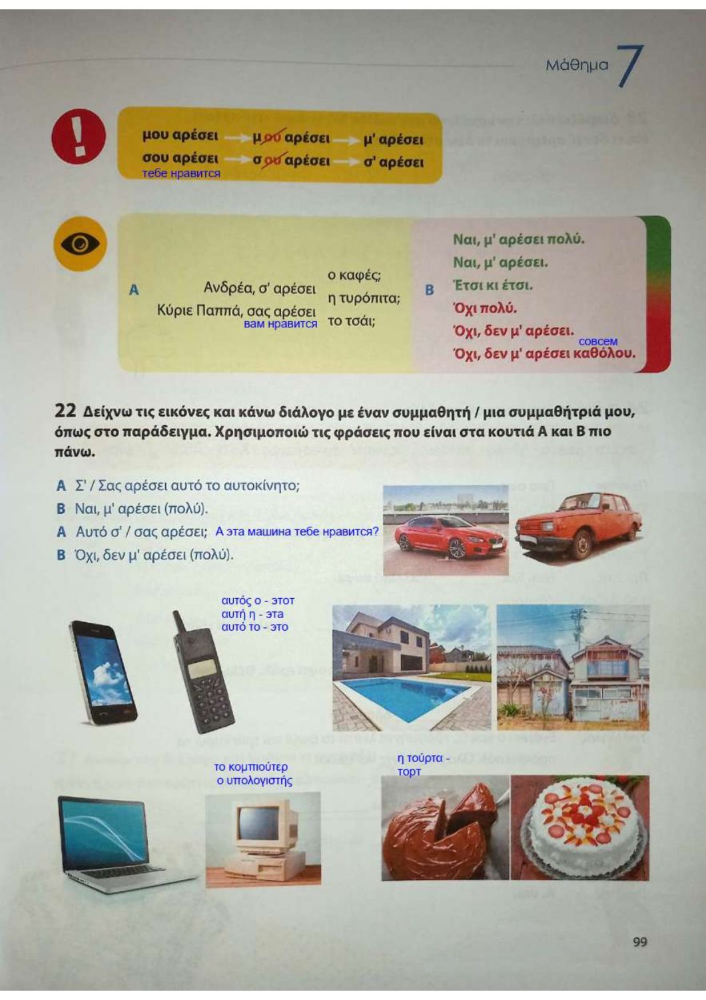

# Урок 23 — что нравится, свободное время и повторение

[Памятка A4](../assets/print/lesson-23-study-card-a4.pdf){ .md-button }
[Карточки для телефона](../assets/mobile/lesson-23-phone-cards.pdf){ .md-button }
[Домашка для печати](../assets/print/lesson-23-homework.pdf){ .md-button }

[Карточки по темам](../memory/lesson-23-current.md) · [Словарь](../vocabulary/lesson-23.md) · [Домашнее задание](../homework/lesson-23-current.md) · [Тренажёр: три направления](../training/vocabulary.md?lesson=23)

## Что освоить

- Отличать «мне нравится» от «мне нравятся» и говорить, что нравится делать.
- Задать вопрос на «ты» и вежливое «вы», понять сокращённые формы ответа.
- Повторить спряжение, согласование прилагательных и выбор падежа.
- Рассказать о свободном времени, ответить на вопросы о себе и описать распорядок другого человека.

## Разбор

### Мне нравится — мне нравятся { #likes }

Сравни: **Μου αρέσει ο καφές.** `[mu aˈresi o kaˈfes]` — Мне нравится кофе. **Μου αρέσουν τα γλυκά.** `[mu aˈresun ta ɣliˈka]` — Мне нравятся сладости. Форма зависит от того, **что нравится**: один предмет или несколько. Кофе и сладости здесь подлежащие, а **μου** `[mu]` означает «мне».

Если нравится действие, используй **Μου αρέσει να ταξιδεύω.** `[mu aˈresi na taksiˈðevo]` — Мне нравится путешествовать. Во второй части глагол означает «я путешествую». **Σου αρέσει να ταξιδεύεις;** `[su aˈresi na taksiˈðevis]` — Тебе нравится путешествовать? Второй глагол меняется на «ты», первый остаётся в единственном числе.

Алгоритм: назови, кому нравится; найди то, что нравится; выбери единственное или множественное число; если это действие, присоедини его через **να** `[na]`. Для отрицания поставь **δεν** `[ðen]` перед коротким местоимением. [Полное правило с разбором роли слов](../reference/grammar/likes.md)

| Пара из упражнения 4 конспекта | Модель от своего лица |
|---|---|
| поездки / работа | Μου αρέσουν τα ταξίδια, αλλά δεν μου αρέσει η δουλειά. `[mu aˈresun ta taˈksiðia aˈla ðen mu aˈresi i ðuˈlya]` — Мне нравятся поездки, но не нравится работа. |
| Афины / шум | Μου αρέσει η Αθήνα, αλλά δεν μου αρέσει ο θόρυβος. `[mu aˈresi i aˈθina aˈla ðen mu aˈresi o ˈθorivos]` — Мне нравятся Афины, но не нравится шум. В греческом название города в единственном числе. |
| кофе / чай | Μου αρέσει ο καφές, αλλά δεν μου αρέσει το τσάι. `[mu aˈresi o kaˈfes aˈla ðen mu aˈresi to ˈtsai]` — Мне нравится кофе, но не нравится чай. |
| сладости / фрукты | Μου αρέσουν τα γλυκά, αλλά δεν μου αρέσουν τα φρούτα. `[mu aˈresun ta ɣliˈka aˈla ðen mu aˈresun ta ˈfruta]` — Мне нравятся сладости, но не нравятся фрукты. |
| овощи / горох | Μου αρέσουν τα λαχανικά, αλλά δεν μου αρέσει ο αρακάς. `[mu aˈresun ta lahaniˈka aˈla ðen mu aˈresi o araˈkas]` — Мне нравятся овощи, но не нравится горох. |
| мусака / чечевица | Μου αρέσει ο μουσακάς, αλλά δεν μου αρέσουν οι φακές. `[mu aˈresi o musaˈkas aˈla ðen mu aˈresun i faˈkes]` — Мне нравится мусака, но не нравится чечевица. Последнее название в греческом во множественном числе. |

В пункте 7 — **τα βουτήματα** `[ta vuˈtimata]`, печенье для обмакивания: **Μου αρέσουν τα βουτήματα, αλλά δεν μου αρέσει το παγωτό.** `[mu aˈresun ta vuˈtimata aˈla ðen mu aˈresi to paɣoˈto]` — Мне нравится такое печенье, но не нравится мороженое. Пометка преподавателя связывает слово с **βουτάω** `[vuˈtao]` — обмакиваю, погружаю.

| Остальные пары | Модель |
|---|---|
| обувь / брюки | Μου αρέσουν τα παπούτσια, αλλά δεν μου αρέσει το παντελόνι. `[mu aˈresun ta paˈputsya aˈla ðen mu aˈresi to pandeˈloni]` — Мне нравится обувь, но не нравятся брюки. В греческом «брюки» в единственном числе. |
| покупки / движение | Μου αρέσουν τα ψώνια, αλλά δεν μου αρέσει η κίνηση. `[mu aˈresun ta ˈpsonya aˈla ðen mu aˈresi i ˈkinisi]` — Мне нравятся покупки, но не нравится дорожное движение. |
| собаки / кошки | Μου αρέσουν οι σκύλοι, αλλά δεν μου αρέσουν οι γάτες. `[mu aˈresun i ˈskili aˈla ðen mu aˈresun i ˈɣates]` — Мне нравятся собаки, но не нравятся кошки. |

В печатных примерах встречаются **της αρέσει** `[tis aˈresi]` «ей нравится» и **του αρέσουν** `[tu aˈresun]` «ему нравятся». Преподаватель вписал ответы от первого лица. Поэтому эти фразы — модели личного ответа, а не рассказа об изображённых мужчине или женщине.

Можно заменить название занятия действием: **Μου αρέσει να πίνω καφέ.** `[mu aˈresi na ˈpino kaˈfe]` — Мне нравится пить кофе. **Μου αρέσει να φοράω τα παπούτσια.** `[mu aˈresi na foˈrao ta paˈputsya]` — Мне нравится носить эту обувь. После глагола «пью / ношу» предмет уже дополнение: не копируй сюда именительный из конструкции «мне нравится».

### Спросить и ответить о вкусах { #preferences }

**Σου αρέσει;** `[su aˈresi]` — Тебе нравится? **Σας αρέσει;** `[sas aˈresi]` — Вам нравится? Вежливость меняет местоимение, но не число предмета. Разговорные **σ’ αρέσει** `[s aˈresi]` и **μ’ αρέσει** `[m aˈresi]` — сокращённые «тебе / мне нравится».

| Вопрос или ответ | Смысл |
|---|---|
| Σας αρέσει αυτό το αυτοκίνητο; `[sas aˈresi afˈto to aftoˈkinito]` | Вам нравится эта машина? |
| Ναι, μου αρέσει πολύ. `[ne mu aˈresi poˈli]` | Да, мне очень нравится. |
| Έτσι κι έτσι. `[ˈetsi ki ˈetsi]` | Так себе. |
| Όχι πολύ. `[ˈohi poˈli]` | Не очень. |
| Όχι, δεν μου αρέσει καθόλου. `[ˈohi ðen mu aˈresi kaˈθolu]` | Нет, мне совсем не нравится. |

В №22 на с. 99 сравниваются две машины, телефоны, дома, компьютеры и торты. Каждый раз можно спросить «эта вещь нравится?» и дать один из ответов выше. Для формы «этот» согласуй род: **αυτός ο υπολογιστής** `[afˈtos o ipoloɣiˈstis]` — этот компьютер; **αυτή η τούρτα** `[afˈti i ˈturta]` — этот торт; **αυτό το σπίτι** `[afˈto to ˈspiti]` — этот дом. [Указательные слова](lesson-16-current.md)

{ loading=lazy }

### Повторение глаголов: с. 109–110, №2 { #verbs }

В этом упражнении важно найти подлежащее и сохранить его лицо во всех однородных действиях. Два имени дают «они». В предложении о транспорте подлежащее в первой части — транспорт, а во второй — Йоргос: формы будут разными.

| № | Формы из конспекта | Что означает |
|---|---|---|
| 1 | είναι `[ˈine]` | Александр и Ксения — из Германии: «они». |
| 2 | δεν ξέρει `[ðen ˈkseri]` | Гайя не знает итальянский хорошо. |
| 3 | σπουδάζει, ξέρει `[spuˈðazi ˈkseri]` | Антон изучает филологию и знает древнегреческий. |
| 4 | διαβάζεις, μαθαίνεις `[ðiaˈvazis maˈθenis]` | Ты читаешь книгу и учишь французский. |
| 5 | μελετάτε, πάτε `[meleˈtate ˈpate]` | Вы занимаетесь в библиотеке, затем идёте за кофе. |
| 6 | κάνουν, δουλεύουν `[ˈkanun ðuˈlevun]` | Они учатся в магистратуре и работают. |
| 7 | ξυπνάει, τρώει, πίνει `[ksiˈpnai ˈtroi ˈpini]` | Мэри просыпается, ест тост, пьёт молоко. |
| 8 | οδηγεί, ακούει, τραγουδάει `[oðiˈɣi aˈkui traɣuˈðai]` | Юлия водит машину, слушает музыку и поёт. |
| 9 | απεργούν, έχει, αργεί `[aperˈɣun ˈehi arˈɣi]` | Транспорт бастует; у Йоргоса проблема, потому что он опаздывает. |
| 10 | αγαπάνε, πηγαίνουν `[aɣaˈpane piˈyenun]` | Дети любят рок и часто ходят в клуб. |

**Όταν** `[ˈotan]` — «когда»: связывает событие с условием по времени. **γιατί** `[yaˈti]` — «потому что», когда вводит причину; в вопросе — «почему?». **μελετάω** `[meleˈtao]` означает «занимаюсь, изучаю материал», а **σπουδάζω** `[spuˈðazo]` — «учусь по специальности». **διαβάζω** `[ðiaˈvazo]` — «читаю», а в учебном контексте также «занимаюсь».

[Глаголы А](../reference/grammar/present-tense-a.md) · [Β1](../reference/grammar/present-tense-b1.md) · [ΑΒ](../reference/grammar/present-tense-ab.md) · [Β2](../reference/grammar/present-tense-b2.md)

### Согласование и падеж: с. 110–111, №3 { #agreement }

Сначала выбери роль существительного, затем его род и число, после этого согласуй прилагательное. После «быть» признак описывает подлежащее; после «иметь» предмет является дополнением; после предлога нужен винительный. Не пользуйся правилом «не подлежащее — всегда винительный»: признак после «быть» тоже стоит в именительном.

| Пример | Разбор |
|---|---|
| Ο φίλος μου είναι καλός κι ευγενικός. `[o ˈfilos mu ˈine kaˈlos ki evyeniˈkos]` | Мой друг хороший и вежливый. Два признака описывают друга, мужской именительный. |
| Έχω μία όμορφη κι έξυπνη αδελφή. `[ˈeho ˈmia ˈomorfi ki ˈeksipni aðelˈfi]` | У меня красивая и умная сестра. После «имею» — дополнение; женская форма внешне совпадает с именительным. |
| Μένω σε μια μικρή αλλά καθαρή πολυκατοικία. `[ˈmeno se mya miˈkri aˈla kaθaˈri polikatiˈkia]` | Живу в небольшом, но чистом многоквартирном доме. Предлог задаёт винительный. |
| Αυτό το δώρο είναι για τον μικρό αδελφό μου. `[afˈto to ˈðoro ˈine ya ton miˈkro aðelˈfo mu]` | Этот подарок для моего младшего брата. После «для» изменяются артикль, прилагательное и существительное. |
| Θα ήθελα ένα κρύο ποτό. `[θa ˈiθela ˈena ˈkrio poˈto]` | Я хотел бы холодный напиток. Средний род: предмет желания, винительный. |
| Ο Κώστας είναι χοντρός και κοντός. `[o ˈkostas ˈine honˈdros ke konˈdos]` | Костас полный и невысокий. Описания внешности: именительный. |

В остальных пунктах повторяются семья, общежитие, молодая / стройная / высокая / красивая, маленький дом, современная музыка, английский ученик, красивая Испания, дорогая блузка, большая / узкая улица, чистая / грязная скульптура и хороший урок. **Στην τάξη μας υπάρχει μόνο ένας Άγγλος μαθητής.** `[stin ˈtaksi mas iˈparhi ˈmono ˈenas ˈaŋglos maθiˈtis]` — В нашем классе есть только один английский ученик. После «существует / имеется» ученик — подлежащее, поэтому именительный.

**μπροστά από το μουσείο** `[broˈsta aˈpo to muˈsio]` — перед музеем. Это составное выражение места: здесь **από** `[aˈpo]` не переводится отдельно как «из». [Полное правило падежа](../reference/grammar/accusative-singular.md) · [Прилагательные](../reference/grammar/adjectives-e1-e2.md)

### Диалог о свободном времени { #listening }

На листе аудирования нужно отметить шесть ответов, не считая примера учительницы. Ниже полный печатный диалог: его можно прочитать и разобрать до самостоятельного пересказа.

| Кто и реплика | Произношение | Близкий перевод |
|---|---|---|
| Учительница: Καλημέρα σας! Σήμερα θα μιλήσουμε για τον ελεύθερο χρόνο μας. Ξεκινάω εγώ. Λοιπόν… Όταν έχω ελεύθερο χρόνο, διαβάζω βιβλία. Γιώργο, η σειρά σου… | `[kaliˈmera sas ˈsimera θa miˈlisume ya ton eˈlefθero ˈhrono mas ksiˈkinao eˈɣo liˈpon ˈotan ˈeho eˈlefθero ˈhrono ðiaˈvazo viˈvlia ˈyorɣo i siˈra su]` | Доброе утро! Сегодня поговорим о нашем свободном времени. Начинаю я. Итак… Когда у меня есть свободное время, я читаю книги. Йоргос, твоя очередь… |
| Йоргос: Εγώ βλέπω ταινίες. Μου αρέσει να πηγαίνω στον κινηματογράφο. Εκεί βλέπω τις ταινίες σε μεγάλη οθόνη. | `[eˈɣo ˈvlepo teˈnies mu aˈresi na piˈyeno ston kinimatoˈɣrafo eˈki ˈvlepo tis teˈnies se meˈɣali oˈθoni]` | Я смотрю фильмы. Мне нравится ходить в кино. Там смотрю фильмы на большом экране. |
| Учительница: Εσύ, Δήμητρα, τι κάνεις στον ελεύθερο χρόνο σου; | `[eˈsi ˈðimitra ti ˈkanis ston eˈlefθero ˈhrono su]` | А ты, Димитра, что делаешь в свободное время? |
| Димитра: Κι εγώ βλέπω ταινίες, στην τηλεόραση ή στον υπολογιστή. Όμως, πιο πολύ μου αρέσει η ζωγραφική. Κάθε απόγευμα ζωγραφίζω. | `[ki eˈɣo ˈvlepo teˈnies stin tileˈorasi i ston ipoloɣiˈsti ˈomos pyo poˈli mu aˈresi i zoɣrafiˈki ˈkaθe aˈpoyevma zoɣraˈfizo]` | Я тоже смотрю фильмы, по телевизору или на компьютере. Но больше мне нравится рисование. Каждый день после обеда я рисую. |
| Учительница: Εσύ, Μιχάλη; | `[eˈsi miˈhali]` | А ты, Михалис? |
| Михалис: Εγώ δεν ζωγραφίζω και δεν βλέπω ταινίες. Μου αρέσει να μαγειρεύω. Είμαι συνέχεια στην κουζίνα. | `[eˈɣo ðen zoɣraˈfizo ke ðen ˈvlepo teˈnies mu aˈresi na mayiˈrevo ˈime siˈnehia stin kuˈzina]` | Я не рисую и не смотрю фильмы. Мне нравится готовить. Я постоянно на кухне. |
| Учительница: Μαρίνα, η σειρά σου… | `[maˈrina i siˈra su]` | Марина, твоя очередь… |
| Марина: Κι εγώ μαγειρεύω συχνά. Επίσης, μου αρέσει να διαβάζω. Αγαπάω πολύ τα βιβλία. | `[ki eˈɣo mayiˈrevo siˈhna eˈpisis mu aˈresi na ðiaˈvazo aɣaˈpao poˈli ta viˈvlia]` | Я тоже часто готовлю. Ещё мне нравится читать. Я очень люблю книги. |
| Учительница: Πολύ ωραία, παιδιά! Τώρα κάνουμε διάλειμμα. | `[poˈli oˈrea peˈðya ˈtora ˈkanume ðiˈalima]` | Очень хорошо, ребята! Теперь делаем перерыв. |

**κι εγώ** `[ki eˈɣo]` — «и я / я тоже»; **όμως** `[ˈomos]` — «однако»; **πιο πολύ** `[pyo poˈli]` — «больше»; **συνέχεια** `[siˈnehia]` — «постоянно»; **επίσης** `[eˈpisis]` — «также»; **η σειρά σου** `[i siˈra su]` — «твоя очередь». Начальное **θα μιλήσουμε** `[θa miˈlisume]` означает «мы поговорим»; пока достаточно узнавать эту готовую реплику, она не требует нового полного разбора будущего времени.

??? success "Сверка таблицы по печатному диалогу"

    Учительница читает — пример. Йоргос смотрит фильмы; Димитра рисует и смотрит фильмы; Михалис готовит; Марина читает и готовит. Итого шесть отметок. Особенно важно: Димитра предпочитает рисование, но не отрицает просмотр фильмов.

## Практика перед домашкой

1. Скажи, что тебе нравится: один предмет, несколько предметов и действие. Проверь число глагола.
2. Спроси собеседника о кофе сначала на «ты», затем вежливо. Ответь «совсем не нравится».
3. Вспомни разницу «учусь по специальности / читаю», «всегда / редко», «внук / племянник». Эти пары нужны на с. 111.
4. Прочитай диалог и перескажи одним предложением занятие каждого человека. [Слова для трёх направлений тренировки](../training/vocabulary.md?lesson=23)

## Домашнее задание

Учебник: **с. 111 №4**, **с. 112 №5**, **с. 113**. В сообщении учителя назван №6, но уточнение «что Йоргос делает каждый день» относится к №7; в книге №7 спрашивает о каждой пятнице. На печатном листе есть оба упражнения. [Точные формулировки, подсказки и листы](../homework/lesson-23-current.md)
